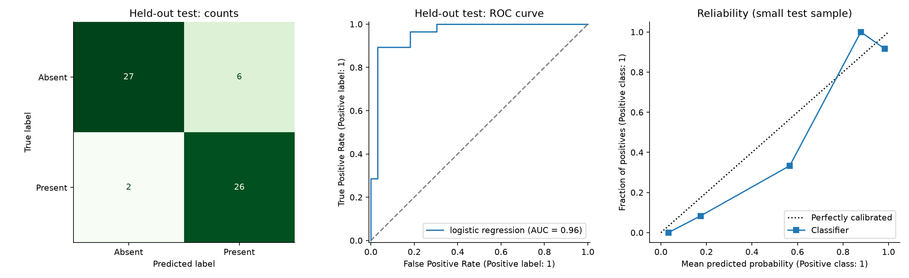
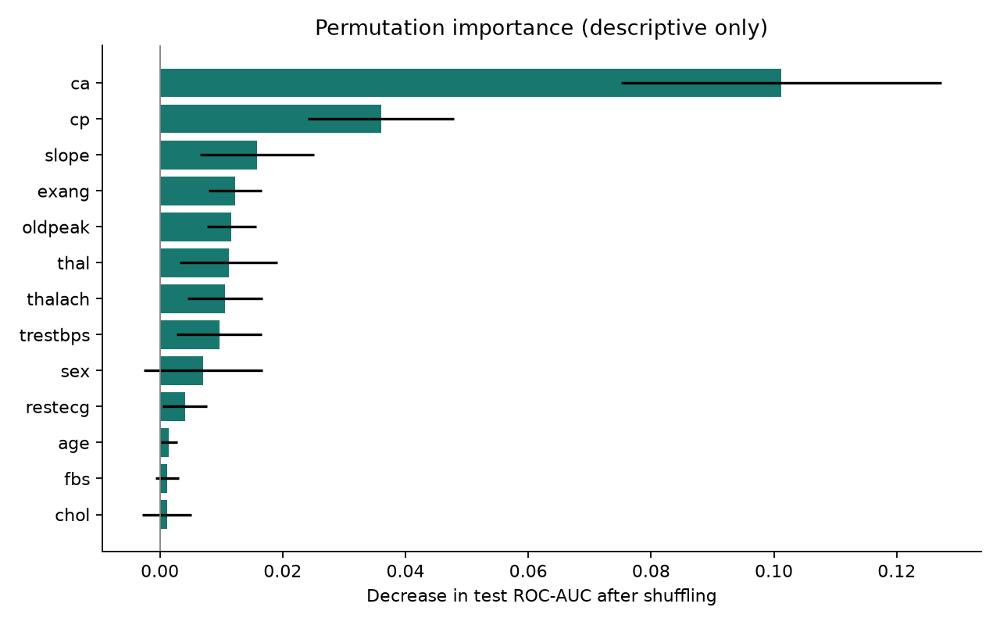

# Evaluation report

Selected model: **logistic_regression**. Training rows: 242. Held-out test rows: 61.

## Model selection
Fixed candidates were compared on identical stratified five-fold splits of training data.
Preprocessing was fitted within each fold. Highest mean ROC-AUC determined the winner.
Cross-validation scores were used for selection and are not an unbiased final estimate.
No hyperparameter search or threshold optimization was performed. Threshold: 0.5.

| Model | CV ROC-AUC mean | Fold standard deviation |
|---|---:|---:|
| dummy | 0.500 | 0.000 |
| logistic_regression | 0.906 | 0.022 |
| random_forest | 0.898 | 0.031 |
| xgboost | 0.888 | 0.026 |

## Held-out evaluation
- ROC-AUC: 0.958; stratified bootstrap 95% interval: [0.899, 0.997].
- Accuracy: 0.869; positive-class precision: 0.812.
- Positive-class recall: 0.929; F1: 0.867; specificity: 0.818.
- Average precision: 0.941; Brier score: 0.085 (lower is better).
- True negatives: 27; false positives: 6; false negatives: 2; true positives: 26.

The interval reflects resampling this test sample with the model fixed; it excludes training,
model-selection and population-shift uncertainty. It is not a clinical validation interval.
CV precision/recall/F1 in the CSV are macro averages; test precision/recall/F1 above refer to class 1.

## Interpretation and limitations
Permutation importance is a post-evaluation description, not a feature-selection procedure.
Its error bars describe repeat-to-repeat shuffling variability, not confidence intervals.
Correlated features can share importance. Associations do not establish causes.
The reliability plot uses only five bins because the test set is small. Scores are uncalibrated.
This historical sample does not establish performance in modern or different populations.
The saved demo model is the evaluated training-only model; it was not refitted on the test set.
Repeatedly changing the project after inspecting test results would compromise the holdout.

